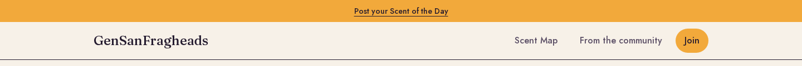
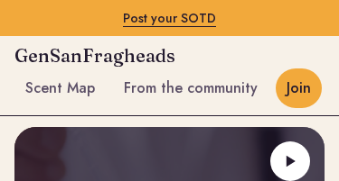
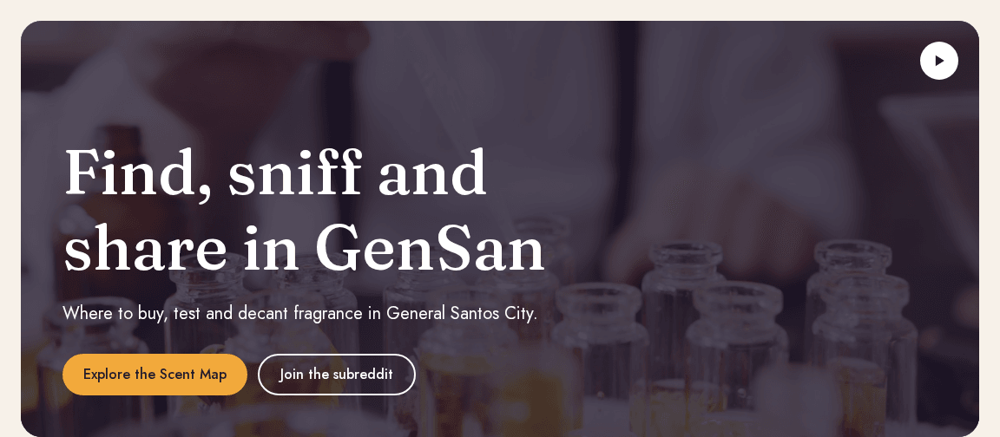
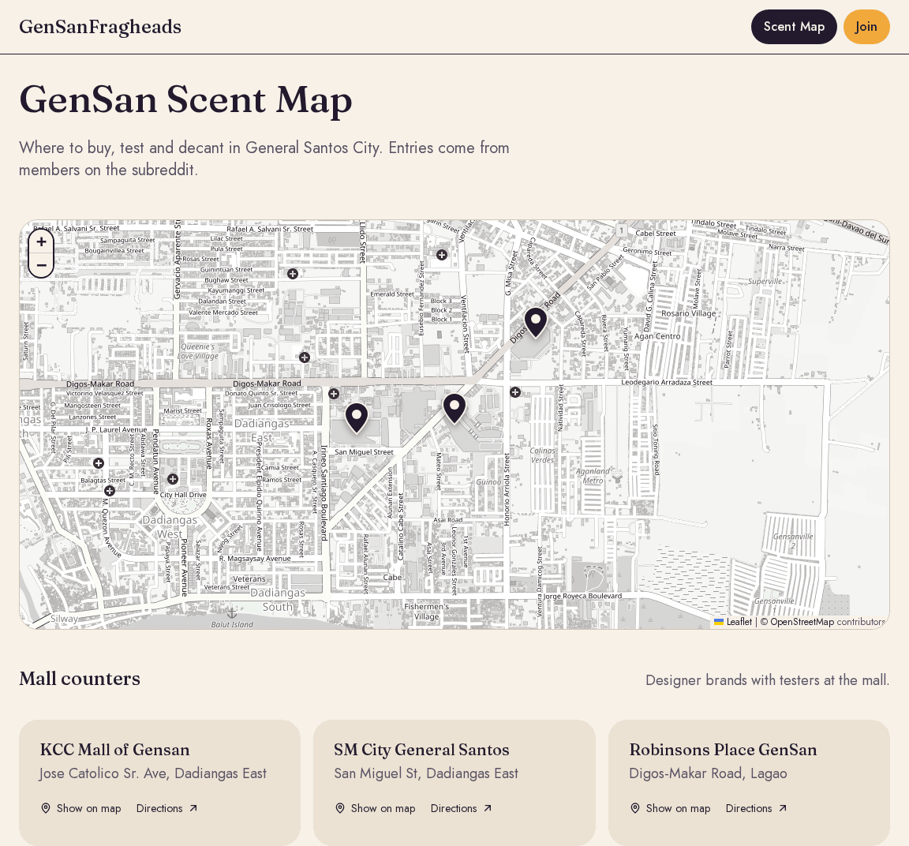
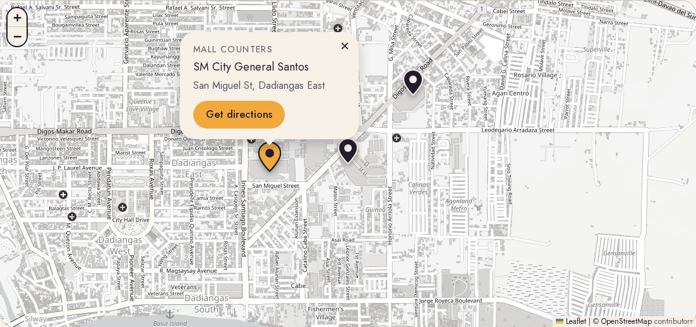
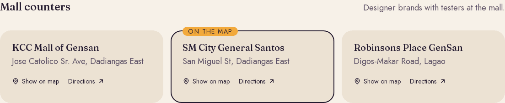
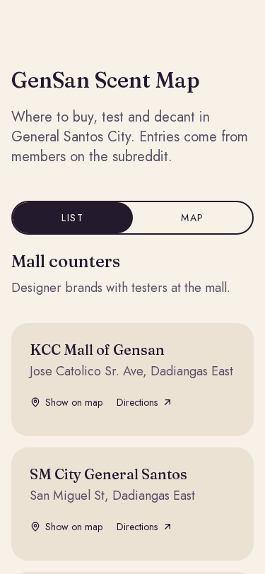
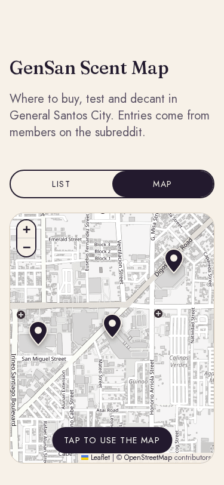
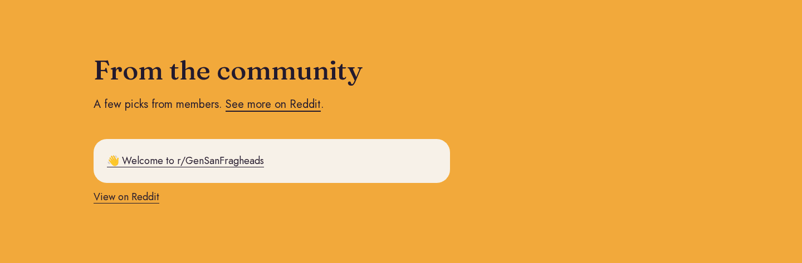
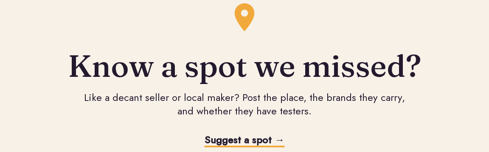

# GenSanFragheads

One-page static website for the [r/GenSanFragheads](https://www.reddit.com/r/GenSanFragheads) fragrance community in General Santos City. Built with Next.js (App Router, static export), TypeScript and Tailwind CSS.

Live site: <https://gensanfragheads.pages.dev> (Cloudflare Pages, deployed from `main`).

## Visitor walkthrough

The site is one scrolling page. This tour follows it from top to bottom. Desktop screenshots are at 1440px wide, phone screenshots at 375px.

### Header and menu

A saffron strip at the very top links to the subreddit to post your Scent of the Day. Below it, the header has the site name (back to the top of the page), **Scent Map** and **From the community** links that jump to those sections, and a **Join** button that opens the subreddit. **From the community** is only listed while there are community posts to show. On desktop the header stays pinned while you scroll, and each menu link is highlighted while its section is on screen.



On a phone the strip reads "Post your SOTD", the menu wraps under the site name, and the header scrolls away with the page.



### Hero

The opening panel says "Find, sniff and share in GenSan" over a looping video of a perfumer at work. **Explore the Scent Map** scrolls to the map and **Join the subreddit** opens Reddit. The round button in the top right corner pauses or plays the video. Visitors who ask for reduced motion see a still image instead.



### Scent Map

The GenSan Scent Map lists places in General Santos City to buy, test and decant fragrance, as shared by subreddit members. On desktop the map sits on top and the spot cards below it.



#### Map pins and popups

Each pin is a spot. Click or tap a pin to open its popup with the kind of spot, its name, its location and a **Get directions** button that opens Google Maps in a new tab. The open spot's pin turns saffron. Drag to pan and use the **+** and **−** buttons to zoom; the mouse wheel scrolls the page, not the map. Press Escape or the **×** to close the popup.



#### Spot cards

Below the map, the spots are grouped by kind:

- **Mall counters** (`counter`): designer brands with testers at the mall.
- **Decant sellers** (`decant`): small samples so you can try before a full bottle.
- **Local makers** (`local-maker`): perfumes and oils made in GenSan and Mindanao.

A group only shows once it has at least one spot, so today only Mall counters is listed. Each card has the spot's name and location. Pinned spots also get **Show on map**, which opens that spot's popup on the map, and **Directions**, which opens Google Maps. The card for the spot open on the map gets an outline and an "On the map" badge.



#### On a phone: list, map and the locked map

On a phone the section opens on the **List** view, which works before the map has loaded. Switch to **Map** with the toggle above it, or tap **Show on map** on a card.



The map starts locked so that swiping over it scrolls the page instead of getting stuck on the map. Pins and popups still respond to taps. To pan the map, tap **Tap to use the map** at the bottom, then drag with one finger. Touching anywhere outside the map locks it again.



### From the community

A saffron band shows a few hand-picked posts from the subreddit, embedded by Reddit, with a **View on Reddit** link under each and a **See more on Reddit** link in the intro. If Reddit's embed cannot load, each post stays as a plain link to the post, as in this screenshot.



### Suggest a spot

"Know a spot we missed?" asks visitors to share a decant seller, local maker or other spot. **Suggest a spot** opens a new subreddit post with the title "Scent Map suggestion: " and a short template for the name, location, brands, testers and price range already filled in.



### Join the subreddit

The last panel, "Join the conversation", points to Reddit for Scent of the Day posts, recommendations and meetups. **Join the subreddit** opens r/GenSanFragheads. The footer below repeats the Scent Map link and the subreddit link.


## Develop

```bash
npm install
npm run dev     # http://localhost:3000
npm run build   # static site in out/
```

`out/` can be deployed to any static host (GitHub Pages, Cloudflare Pages, Netlify). Set `NEXT_PUBLIC_SITE_URL` (e.g. `https://example.com`) at build time so share previews get absolute URLs; a production build fails without it. `npm run dev` works without it.

## Editing content

The home page is a single scrolling page: a hero, the Scent Map and a join call to action. The Scent Map content lives in `src/data/`, so updating it rarely means touching page code:

| File | Section |
| --- | --- |
| `src/data/scent-map.json` | Scent Map spots, group names and descriptions, map center |
| `src/data/community-posts.json` | Reddit posts to feature; the section is hidden while the list is empty |

Field types and notes for these files are in `src/lib/data.ts`, which also checks the references when the site builds: an unknown `kind` fails the build with a message naming the entry. In short:

- A spot needs `name`, `kind` (`counter`, `decant` or `local-maker`) and `location`. Add `coords` as `[latitude, longitude]` to pin it on the map (right-click a place on openstreetmap.org and choose Show address to get them); leave it out for online-only sellers. `notes` and `link` are optional.
- A community post needs `title` and `url`. Open the post in a browser and copy the address bar; `/s/` share links fail the build. Posts are embedded by Reddit's script, with a plain link as fallback.

Site name, subreddit link and the section labels are in `src/lib/site.ts`. The menu order is in `src/lib/nav.ts`.
